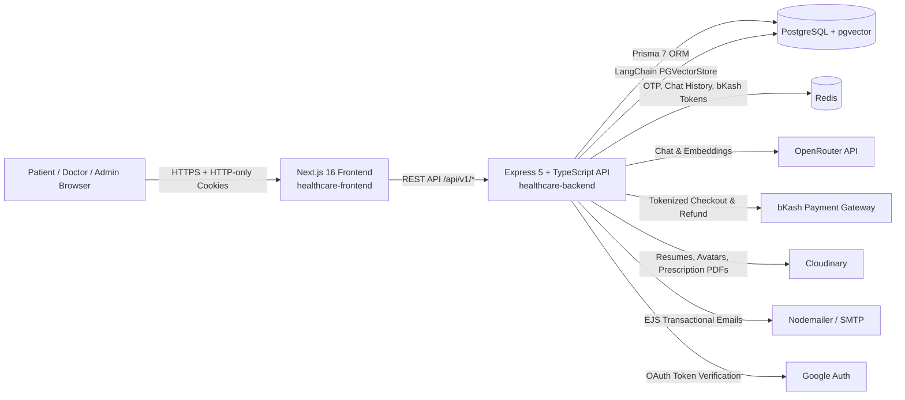

# AI-Powered Hospital Management System (Bangladesh Specialized Hospital)

A full-stack healthcare management platform and patient portal for **Bangladesh Specialized Hospital**, featuring an **AI RAG (Retrieval-Augmented Generation) Healthcare Assistant**, a verified specialist doctor directory, 20-minute slot scheduling, **bKash** tokenized payment & automated refund integration, **PDFKit** digital prescriptions, and role-based dashboards for **Patients**, **Doctors**, and **Admins**.

---

## 🌐 Live Deployed Application

| Service | Live URL | Description |
| --- | --- | --- |
| **Frontend Web Portal** | [https://healthcare-frontend-production-3ce69b5c.up.railway.app](https://healthcare-frontend-production-3ce69b5c.up.railway.app) | Public portal, specialist search, doctor booking, and AI Medical Assistant |
| **Backend REST API** | [https://healthcare-backend-production-9c03f7c4.up.railway.app](https://healthcare-backend-production-9c03f7c4.up.railway.app) | Express 5 + Prisma 7 + PostgreSQL (`pgvector`) + Redis |
| **API Health Check** | [https://healthcare-backend-production-9c03f7c4.up.railway.app/](https://healthcare-backend-production-9c03f7c4.up.railway.app/) | Root health check (`{"success":true,"message":"..."}`) |
| **Public Doctors API** | [https://healthcare-backend-production-9c03f7c4.up.railway.app/api/v1/doctor/public/all-doctors](https://healthcare-backend-production-9c03f7c4.up.railway.app/api/v1/doctor/public/all-doctors) | Public verified specialist catalog |
| **Railway Project** | [Railway Project Dashboard](https://railway.com/project/4a52d4a0-79a0-4533-bb79-016696852882) | Full infrastructure: Frontend, Backend & Redis services |

---

## Table of Contents

- [Live Deployed Application](#-live-deployed-application)
- [Key Features](#key-features)
- [System Architecture](#system-architecture)
- [AI RAG Doctor-Finding Pipeline](#ai-rag-doctor-finding-pipeline)
- [Tech Stack](#tech-stack)
- [Repository Structure](#repository-structure)
- [Role & Access Matrix](#role--access-matrix)
- [Quick Start Guide](#quick-start-guide)
- [Core End-to-End Workflows](#core-end-to-end-workflows)
- [Documentation](#documentation)
- [Troubleshooting](#troubleshooting)

---

## Key Features

- **AI RAG Healthcare Assistant (`POST /api/v1/chat`)**
  - Semantic doctor discovery powered by **LangChain**, **OpenRouter** (chat + embedding models with automatic fallback models), and **PostgreSQL `pgvector`** cosine similarity search.
  - Multi-turn conversational memory stored in **Redis** (up to 10 messages per session, 1-hour TTL) with automatic follow-up question condensation.
  - Real-time hydration of today's published schedules and available slots from PostgreSQL so recommendations reflect live availability.
  - Built-in clinical safety guardrails (no medical diagnosis or prescribing; immediate emergency escalation guidance).
- **Specialist Discovery & Public Portal**
  - Searchable, filterable, sortable, and paginated doctor directory across 34+ clinical specialties.
  - Dedicated specialist profile pages displaying BMDC license, qualifications, experience, bio, consultation fee (BDT), and live open consultation slots for today.
- **Role-Based Portals & Authentication**
  - Credential registration with **6-digit email OTP verification** (Redis-backed), **Google OAuth 2.0**, forgot/reset password flow, and HTTP-only JWT access/refresh cookies.
  - Dedicated dashboards protected by route and role guards: **Patient (`/dashboard`)**, **Doctor (`/doctor`)**, and **Admin / Super Admin (`/admin`)**.
- **Doctor Onboarding & Verification Workflow**
  - Prospective doctors apply with resume and up to 10 supporting documents uploaded via Multer + **Cloudinary**, verify their email via OTP, and undergo Admin review (`PENDING` -> `APPROVED` / `REJECTED`).
  - Approval automatically generates a temporary password, sends an EJS-rendered notification email, and syncs the doctor's vector embedding into `pgvector`.
- **Smart Scheduling & Appointment Booking**
  - Doctors create one schedule per day as a `DRAFT` and publish it to `PUBLISHED`. Schedule durations are automatically split into **20-minute consultation slots** with a Google Meet link.
  - Patients book open slots via **bKash Tokenized Checkout**. Successful callbacks confirm the booking, assign a sequential `serialNumber` and calculated `joiningTime`, decrement available slots, and email a PDF receipt.
  - Cancellations restore available slots and trigger an automatic **bKash refund** when cancelled more than 1 hour prior to `startDateTime`.
- **Digital Prescriptions & Analytics**
  - Doctors issue structured prescriptions (findings + medicines) for `COMPLETED` appointments; the backend renders a branded PDF via **PDFKit**, uploads it to **Cloudinary**, and emails it to the patient.
  - Role-specific analytics endpoints for Patients, Doctors, and Admins.
- **Automated Maintenance (Cron Jobs)**
  - Every 10 minutes: purges unverified pending doctor applications older than 1 hour.
  - Daily at 3:00 AM: re-indexes all approved doctors into `pgvector`.

---

## System Architecture



---

## AI RAG Doctor-Finding Pipeline

1. **Indexing (`chat.indexer.ts` / `index:doctors`)**: Approved, non-deleted doctors are formatted into structured text documents (`name`, `specialization`, `qualifications`, `experienceYears`, `bio`), embedded via OpenRouter embeddings, and stored in the `doctor_embeddings` table (`pgvector`) in batches of 20. Embeddings also auto-sync when a doctor is approved or updates their profile, plus nightly at 3:00 AM.
2. **Session Memory**: Each chat session receives a UUID `sessionId` stored in Redis under `chat:session:<sessionId>` (capped at 10 messages, 1-hour expiry).
3. **Query Condensation**: If conversation history exists, LangChain rewrites follow-up questions into a standalone doctor-search query preserving names and specialties.
4. **Vector Retrieval**: Cosine similarity search retrieves the top `K = 4` matching `doctorId`s from `doctor_embeddings`.
5. **Live Schedule Hydration**: Prisma queries those `doctorId`s with today's upcoming `PUBLISHED` schedules that still have `availableSlots > 0`.
6. **Grounded Response**: The primary OpenRouter chat model (with configured fallback models and retry logic) generates a concise response grounded strictly in the retrieved database context and returns clickable doctor recommendation cards to the frontend widget.

> A visual architecture diagram of the chatbot pipeline is available at [`healthcare-backend/Doctor-Finding Chatbot Architecture.png`](./healthcare-backend/Doctor-Finding%20Chatbot%20Architecture.png).

---

## Tech Stack

| Layer | Technologies |
| --- | --- |
| **Frontend** | Next.js 16 (App Router, Static Export), React 19 (React Compiler), TypeScript, Tailwind CSS v4, shadcn/ui (`@base-ui/react`), TanStack Query v5, TanStack Form, Zod v4, `ofetch`, `@react-oauth/google`, `lucide-react`, `date-fns` |
| **Backend** | Node.js 20+ / Bun, Express 5, TypeScript, Prisma 7 (`@prisma/adapter-pg`), Zod v4, `bcryptjs`, `jsonwebtoken`, `cookie-parser`, `node-cron`, `tsup` |
| **AI & RAG** | LangChain (`@langchain/core`, `@langchain/openai`, `@langchain/pgvector`), OpenRouter SDK & API, PostgreSQL `pgvector` |
| **Data & Cache** | PostgreSQL 14+ (with `vector` extension), Redis |
| **Integrations** | bKash Tokenized Checkout & Refund API, Cloudinary, Multer, PDFKit, Nodemailer + EJS, Google OAuth 2.0 |
| **Code Quality** | Biome (formatter & linter) in both frontend and backend |

---

## Repository Structure

```text
HealthCare with RAG/
├── README.md                              # Project overview & full-stack guide (this file)
├── healthcare-backend/                    # Express 5 + Prisma 7 + pgvector + LangChain API
│   ├── README.md                          # Detailed backend architecture, schema, & API reference
│   ├── Project Requirements.md            # Functional & domain specification
│   ├── FRONTEND_PLAN.md                   # UI architecture & roadmap notes
│   ├── Doctor-Finding Chatbot Architecture.png
│   ├── L2B7 Ph-Healthcare.postman_collection.json
│   ├── prisma/
│   │   ├── schema/                        # Multi-file Prisma schema (User, Patient, Doctor, Schedule, Appointment, Payment, Embeddings)
│   │   └── migrations/                    # Committed SQL migrations
│   └── src/
│       ├── server.ts                      # Bootstraps DB, Redis, SMTP, seeders, cron jobs, HTTP server
│       ├── app.ts                         # Express app, CORS, parsers, v1 routes, error handling
│       └── app/
│           ├── config/                    # Centralized environment config
│           ├── lib/                       # Prisma, Redis, LLM, PGVectorStore, bKash, Cloudinary, Multer, Nodemailer, Cron, Google Auth
│           ├── middleware/                # JWT/RBAC guard, Zod validator, global error handler, 404 handler
│           ├── module/                    # 9 domain modules: auth, user, doctor, schedule, appointment, payment, prescription, analytics, chat
│           ├── scripts/                   # Vector indexing & OpenRouter smoke-test scripts
│           ├── templates/                 # 6 EJS transactional email templates
│           └── utils/                     # Seeders (roles + 75 doctors), JWT, AppError, catchAsync, sendResponse
└── healthcare-frontend/                   # Next.js 16 + React 19 + Tailwind v4 Web Portal
    ├── README.md                          # Detailed frontend routes, components, hooks, & build guide
    ├── public/                            # Static assets & auth imagery
    └── src/
        ├── app/                           # App Router pages: (public)/(marketing), (public)/(authentication), (dashboard)/{dashboard,doctor,admin}
        ├── api/                           # Typed ofetch API wrappers (auth, doctor, schedule, appointment, chat)
        ├── components/                    # Auth guards, dashboard shell, forms, layout, feature modules (chat widget, doctors, schedules, approvals), ui primitives
        ├── hooks/                         # TanStack Query hooks & utilities
        ├── lib/                           # ofetch apiClient & Tailwind cn helper
        ├── providers/                     # GoogleAuthProvider, QueryProvider, TooltipProvider
        ├── routes/                        # Role-based sidebar navigation configs
        ├── types/                         # TypeScript interfaces & response envelopes
        ├── utils/                         # Formatting helpers
        └── validation/                    # Client-side Zod schemas
```

---

## Role & Access Matrix

| Role | Registration / Creation | Primary Capabilities | Frontend Portal |
| --- | --- | --- | --- |
| **`PATIENT`** | Self-registration + OTP or Google OAuth | Browse doctors, use AI RAG assistant, book & pay appointments via bKash, cancel/refund, view appointments, payments, prescriptions, analytics | `/dashboard` |
| **`DOCTOR`** | Apply via `/apply` + OTP + Admin approval | Manage profile & fee, create/publish/delete daily schedules, manage consultation statuses, generate PDF prescriptions, view doctor analytics | `/doctor` |
| **`ADMIN`** | Seeded on startup (`TESTER_ADMIN_*`) | Review doctor applications (approve/reject), view all doctors, schedules, appointments, payments, and platform analytics | `/admin` |
| **`SUPER_ADMIN`** | Seeded on startup (`SUPER_ADMIN_*`) | Full administrative privileges across all management and analytics endpoints | `/admin` |

---

## Quick Start Guide

### Prerequisites

- **Node.js 20+** and/or **Bun 1.4+** (both workspaces include `bun.lock`)
- **PostgreSQL 14+** with the **`pgvector`** extension enabled (`CREATE EXTENSION IF NOT EXISTS vector;`)
- **Redis** instance (local or cloud such as Redis Labs)
- **OpenRouter API Key** (for the AI RAG chat and embeddings)
- Optional for full feature testing: **Cloudinary** credentials, **bKash Sandbox** credentials, **Google OAuth Client ID**, and **SMTP** credentials (the server boots gracefully even if SMTP credentials are not configured yet).

### 1. Backend Setup (`healthcare-backend`)

```bash
cd healthcare-backend

# 1. Install dependencies (postinstall automatically runs `prisma generate`)
bun install

# 2. Configure environment variables
cp .env.example .env
# Edit .env with your DATABASE_URL, REDIS_*, JWT_*, OPENROUTER_*,
# CLOUDINARY_*, BKASH_*, GOOGLE_CLIENT_ID, SMTP_*, and seed account credentials.
# See healthcare-backend/README.md for the full variable reference (including OPENROUTER_* vars).

# 3. Apply database migrations (enables pgvector & creates all tables)
bunx prisma migrate deploy

# 4. (Optional) Seed 75 sample specialist doctors across 69 specializations
bun run seed:doctors

# 5. (Optional) Verify OpenRouter LLM & Embedding connectivity
bun run test:openrouter

# 6. Index approved doctors into pgvector for the AI RAG assistant
bun run index:doctors

# 7. Start the development server (default: http://localhost:5000)
bun run dev
```

Verify the backend is healthy:
```bash
curl http://localhost:5000/
# {"success":true,"message":"Welcome to Bangladesh Specialized Hospital Backend"}
```

### 2. Frontend Setup (`healthcare-frontend`)

```bash
cd healthcare-frontend

# 1. Install dependencies
bun install

# 2. Create .env.local
cat <<EOF > .env.local
NEXT_PUBLIC_API_BASE_URL=http://localhost:5000/api/v1
NEXT_PUBLIC_GOOGLE_CLIENT_ID=your-google-oauth-client-id
EOF

# 3. Start the Next.js dev server (default: http://localhost:3000)
bun run dev
```

Open [http://localhost:3000](http://localhost:3000) in your browser.

> **Important Note on Production Builds:** `healthcare-frontend/next.config.ts` uses `output: "export"` and pre-generates doctor detail pages (`/doctors/[id]`) via `generateStaticParams()`. Keep the backend running and reachable at `NEXT_PUBLIC_API_BASE_URL` when running `bun run build` in `healthcare-frontend`.

---

## Core End-to-End Workflows

1. **AI-Assisted Booking Flow**:
   - Patient opens the floating **BSH Medical Assistant** chat widget on `/`, `/doctors`, `/doctors/[id]`, or `/about-us` and describes symptoms.
   - Backend searches `doctor_embeddings` via `pgvector`, hydrates today's live slots from PostgreSQL, and returns tailored specialist recommendations.
   - Patient clicks a recommended doctor card -> opens `/doctors/[id]` -> selects an available slot -> books -> completes **bKash** checkout -> receives confirmation, serial number, joining time, and emailed PDF receipt.
2. **Doctor Application & Approval Flow**:
   - Doctor submits `/apply` with credentials, resume, and supporting files -> receives 6-digit OTP -> verifies at `/apply/verify-account`.
   - Admin logs into `/admin/approve-doctor` -> inspects applicant details & files in the review sheet -> clicks **Approve** or **Reject**.
   - On approval, the doctor receives their login credentials via email and is automatically embedded into `pgvector` for AI search discovery.
3. **Doctor Schedule & Prescription Flow**:
   - Doctor logs into `/doctor/schedules`, creates a schedule (`DRAFT`) with date, time range (>= 20 minutes), and Google Meet URL, then clicks **Publish** (`PUBLISHED`).
   - After consultation, the doctor transitions appointment status (`CONFIRMED` -> `ONGOING` -> `COMPLETED`) and generates a **PDFKit** prescription uploaded to Cloudinary and emailed to the patient.

---

## Documentation

For deeper technical details, see the dedicated workspace guides:

- **[Backend Documentation (`healthcare-backend/README.md`)](./healthcare-backend/README.md)** — Complete REST API reference (all 9 modules), Prisma schema & enums, RAG architecture, environment variable catalog, cron jobs, bKash & PDFKit details, and deployment guide.
- **[Frontend Documentation (`healthcare-frontend/README.md`)](./healthcare-frontend/README.md)** — Complete Next.js App Router map, role guards, component & module catalog, TanStack Query/Form architecture, Zod validation rules, and static export notes.
- **[Project Requirements (`healthcare-backend/Project Requirements.md`)](./healthcare-backend/Project%20Requirements.md)** — Full business requirements and domain specification.
- **[Postman Collection (`healthcare-backend/L2B7 Ph-Healthcare.postman_collection.json`)](./healthcare-backend/L2B7%20Ph-Healthcare.postman_collection.json)** — Ready-to-import API test suite.

---

## Troubleshooting

- **Auth cookies not sent from frontend to backend**: Ensure `FRONTEND_URL` in `healthcare-backend/.env` exactly matches the frontend origin (e.g., `http://localhost:3000`), and `NEXT_PUBLIC_API_BASE_URL` uses the matching hostname (`localhost` vs `127.0.0.1` mismatch drops `SameSite=Lax` cookies).
- **AI Chatbot returns "temporarily unavailable"**: Verify `OPENROUTER_API_KEY`, `OPENROUTER_CHAT_MODEL`, and `OPENROUTER_EMBEDDING_MODEL` are set in `healthcare-backend/.env`, run `bun run test:openrouter`, and ensure doctors have been indexed with `bun run index:doctors`.
- **`pgvector` migration error**: Make sure the `pgvector` extension is installed on your PostgreSQL server before running `prisma migrate deploy`.
- **SMTP warning on startup**: The backend intentionally continues booting if SMTP credentials are missing/invalid; configure valid Gmail App Password / SMTP credentials in `.env` when testing OTP, welcome, or approval emails.
